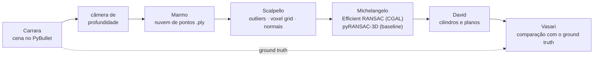

# projectMike

> *"A estátua já está dentro do mármore; o escultor só tira o excesso."*
> (frase atribuída a Michelangelo)

## O problema

Um robô que se desloca sobre tubulações, para planejar onde pisar e por onde
seguir, precisa saber como é o ambiente à sua volta, mas uma nuvem de pontos
crua tem centenas de milhares de pontos: é pesada para guardar, transmitir e
raciocinar sobre ela.

A proposta é resumir a cena em **poucas primitivas geométricas**: tubos e pilares
viram **cilindros** (eixo, raio, comprimento) e piso e paredes viram **planos**.
Algumas dezenas de números no lugar de milhares de pontos.

Para medir se isso funciona, as cenas são geradas em simulação (PyBullet), onde
sabemos exatamente a posição e o tamanho de cada objeto. Assim dá para comparar
as primitivas encontradas com o ground truth.

## A temática Michelangelo

O RANSAC faz com a nuvem de pontos o que o escultor faz com o bloco: a forma
(um cilindro, um plano) já está lá dentro, e o trabalho é descartar o que não
pertence a ela. Cada etapa do pipeline tem um nome dessa história:

| Nome | O que é na escultura | O que é no projeto |
|---|---|---|
| **Carrara** | a pedreira de onde vem o mármore | geração das cenas no PyBullet |
| **Marmo** | o bloco de mármore bruto | a nuvem de pontos bruta (`.ply`) |
| **Scalpello** | o cinzel | filtros: remoção de outliers, voxel grid, normais |
| **Michelangelo** | o escultor | ajuste de primitivas (RANSAC) |
| **David** | a estátua pronta | as primitivas finais: cilindros e planos |
| **Vasari** | o biógrafo que registrou e avaliou as obras | métricas, ground truth e relatórios |

## Pipeline



### Situação atual

| Etapa | Situação |
|---|---|
| Carrara | ✅ duas cenas: `tubos` (piso + 3 cilindros) e `galho` (tubo longo inclinado) |
| Marmo | ✅ câmera virtual, conversão profundidade → pontos 3D, junção de vistas, `.ply` com rótulos por ponto; "aranha" que percorre o galho tirando quadros |
| Scalpello | ⏳ a fazer |
| Michelangelo | ⏳ a fazer |
| David | ⏳ a fazer |
| Vasari | 🟡 já existe a conferência da nuvem contra o ground truth (erro de raio, cobertura angular, arco visível por quadro); faltam as métricas das primitivas |

## Estrutura de pastas

```
.
├── README.md
├── CLAUDE.md
└── src/nuvem_cilindro/
    ├── requirements.txt
    ├── pyrightconfig.json
    ├── scenes/                 # Carrara
    │   ├── tubos.py            #   piso + pilar, tubo no chão e tubo elevado
    │   └── galho.py            #   um tubo comprido e inclinado saindo do chão
    ├── src/                    # Marmo (+ começo de Vasari)
    │   ├── camera.py           #   câmera de profundidade virtual (RGB, profundidade, máscara)
    │   ├── nuvem.py            #   foto → pontos 3D no mundo, junta vistas, salva .ply
    │   └── aranha.py           #   câmera que "escala" o galho e gera um quadro por passo
    ├── scripts/
    │   └── teste_sanidade.py   #   confere se o PyBullet abre e simula
    └── data/
        ├── nuvem.ply           #   nuvem da cena tubos (3 vistas)
        ├── rotulos.npy         #   id do objeto de cada ponto
        ├── gt.json             #   ground truth da cena tubos
        ├── camera_vista.png    #   RGB / profundidade / máscara de uma vista
        └── galho/
            ├── gt.json         #   ground truth do galho
            └── trajetoria.json #   pose da câmera e medidas em cada quadro
```

Os quadros `data/galho/quadro_*.ply` não estão no repositório (cerca de 100 MB);
gere-os com `python src/aranha.py`.

## Como instalar

É preciso **Python 3.10, 3.11 ou 3.12**: o `pybullet` não compila no 3.13.

```bash
cd src/nuvem_cilindro
python3.12 -m venv .venv
source .venv/bin/activate
pip install -r requirements.txt
```

Dependências: `pybullet`, `numpy`, `open3d` e `matplotlib`.

## Como rodar

Sempre de dentro de `src/nuvem_cilindro/`, com o venv ativo:

```bash
python scripts/teste_sanidade.py   # abre o PyBullet com um cilindro caindo
python scenes/tubos.py             # mostra a cena tubos e salva data/gt.json
python scenes/galho.py             # mostra a cena do galho
python src/camera.py               # tira uma foto e salva data/camera_vista.png
python src/nuvem.py                # gera data/nuvem.ply com as 3 vistas (ou: python src/nuvem.py 1)
python src/aranha.py               # gera os quadros em data/galho/ (sem janela)
python src/aranha.py gui           # o mesmo, mostrando a aranha subindo
```

## Referências

- M. A. Fischler e R. C. Bolles (1981). *Random Sample Consensus: A Paradigm for Model Fitting with Applications to Image Analysis and Automated Cartography.* Communications of the ACM. <https://doi.org/10.1145/358669.358692>
- R. Schnabel, R. Wahl e R. Klein (2007). *Efficient RANSAC for Point-Cloud Shape Detection.* Computer Graphics Forum. <https://doi.org/10.1111/j.1467-8659.2007.01016.x>
- CGAL, Shape Detection: <https://doc.cgal.org/latest/Shape_detection/>
- pyRANSAC-3D: <https://github.com/leomariga/pyRANSAC-3D>

## Equipe

- Arthur da Rocha Isoppo
- Carlos Eduardo Lopes Feijó
